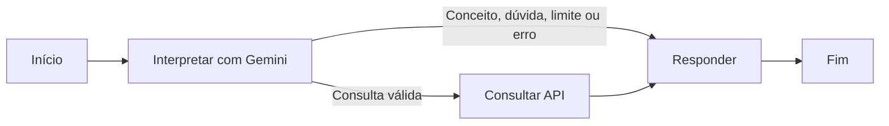

# Assistente de estoque — SCTEC

Projeto avaliativo de agentes de IA: Python, LLM, LangGraph, API de estoque do professor e automação complementar no n8n.

## Objetivo

Responder à pergunta: “Como está o estoque do produto PRD-001?”, consultando os dados reais da API simulada e comparando quantidade disponível e estoque mínimo. Também tratar produtos inexistentes e responder perguntas conceituais sem consulta desnecessária.

## Estado atual

Repositório criado e primeira consulta HTTP à API do professor realizada com sucesso. O agente inicial passou em sete testes locais e nos três cenários reais com Gemini e API do professor. A integração n8n foi executada com sucesso pelo aluno e o workflow foi exportado em JSON. Docker instalado e n8n aberto no navegador, conforme verificação do usuário. Chave Gemini configurada localmente; modelo selecionado: gemini-3.1-flash-lite.

## Executar a API de apoio

Em uma pasta ao lado deste projeto:

```bash
git clone https://github.com/wangsouza/api-estoque.git api-estoque-professor
cd api-estoque-professor
python3 -m venv .venv
.venv/bin/pip install -r requirements.txt
.venv/bin/python -m uvicorn app.main:app --host 127.0.0.1 --port 8000
```

Abra http://127.0.0.1:8000/docs para explorar a API. Em outro terminal:

```bash
curl --fail --silent --show-error http://127.0.0.1:8000/produtos/PRD-001
```

Resultado observado na preparação: Mouse sem fio, quantidade atual 5, estoque mínimo 10. A consulta inicial funcionou; a análise pelo agente também foi validada posteriormente nos três cenários. Este registro não substitui os três testes finais do agente.

## Sequência de desenvolvimento

1. Criar repositório e ambiente; executar uma consulta HTTP à API.
2. Montar LangGraph com LLM, estado compartilhado, nós, transição condicional e encerramento.
3. Demonstrar agente funcional, resposta fundamentada e erro tratado.
4. Integrar n8n via Docker e exportar o workflow JSON.
5. Registrar três testes: análise de estoque, produto inexistente e pergunta conceitual sem API.
6. Completar documentação e gravar vídeo de até cinco minutos.
7. Submeter os links no AVA até 30/11/2026 às 22h.

As etapas seguem o cronograma do curso, avançando conforme a conclusão de cada marco.

## Preparar Docker e abrir n8n

No Linux Mint 22.3, execute no terminal, dentro da pasta `agente-estoque`:

```bash
bash scripts/instalar_docker.sh
sudo docker compose up -d
```

O script configura o repositório oficial do Docker para a base Ubuntu Noble, instala Docker Engine e Compose e executa `hello-world`. Exige senha de administrador, digitada somente no terminal. O Docker informa que derivados como Mint não são oficialmente suportados; esta configuração usa a base Ubuntu do sistema.

Abra http://localhost:5678 e crie a conta local de acesso ao n8n. O volume `n8n_data` conserva os workflows quando o contêiner é parado. O serviço fica acessível apenas neste computador.

```bash
sudo docker compose ps       # verificar o serviço
sudo docker compose logs --tail=50 n8n  # consultar logs
sudo docker compose stop    # parar
sudo docker compose start   # iniciar novamente
```

Instalação concluída e integração demonstrada. O workflow exportado está em `workflows/consulta-estoque.json`.

## Organização Git

A implementação inicial do agente está na branch `feature/agente-langgraph`.

## Ambiente Python do agente

Dentro de `agente-estoque`:

```bash
python3 -m venv .venv
source .venv/bin/activate
python -m pip install -r requirements.txt
```

Copie `.env.example` para `.env` se este ainda não existir. Crie sua chave em https://aistudio.google.com/apikey e preencha `GEMINI_API_KEY` somente no `.env`. Preencha `GEMINI_MODEL=gemini-3.1-flash-lite`, modelo que respondeu ao teste inicial nesta conta; disponibilidade e cotas podem variar. Não envie chaves por chat nem faça commit do `.env`.

Esta venv pertence ao agente e é independente da venv da API do professor. O n8n usa Docker e não depende de nenhuma delas.

## Branches

- `main`: versões prontas para demonstração.
- `develop`: integração do desenvolvimento.
- `feature/...`: trabalho de cada etapa, integrado primeiro em `develop`.

## Conexão HTTP para o n8n

O arquivo `servidor.py` recebe um JSON com `pergunta` e chama o mesmo grafo usado por `main.py`. O n8n não recebe a chave do Gemini e não decide a análise.

Dentro da pasta do projeto, com as dependências instaladas:

```bash
source .venv/bin/activate
python -m uvicorn servidor:app --host 127.0.0.1 --port 8001
```

Mantenha esse terminal aberto. A API do professor também deve continuar funcionando na porta 8000. Para verificar somente o servidor do agente, abra http://127.0.0.1:8001/health. A documentação interativa fica em http://127.0.0.1:8001/docs.

No Linux, o Compose usa `network_mode: host` para que o n8n alcance o agente em `127.0.0.1:8001`. `N8N_LISTEN_ADDRESS=127.0.0.1` mantém o editor acessível somente neste computador. Aplique a alteração com `sudo docker compose up -d`; o volume existente é mantido. Esta configuração de rede é destinada ao Docker Engine no Linux.

O workflow foi montado manualmente pelo aluno: Webhook (POST, caminho `consulta-estoque`) → HTTP Request (POST para `http://127.0.0.1:8001/perguntar`) → Respond to Webhook. A pergunta recebida no corpo do Webhook será enviada ao agente no campo `pergunta`.

Status: o aluno executou o workflow e apresentou os três nós verdes e a resposta real do produto PRD-001 no terminal. O registro transcrito está em `evidencias/integracao_n8n.json`. Os sete testes unitários, incluindo os dois de contrato HTTP, passaram no terminal local do aluno. O resultado exibido na captura foi transcrito em `evidencias/testes_unitarios.json`.

Referências: https://docs.docker.com/engine/network/drivers/host/ e https://docs.n8n.io/integrations/builtin/core-nodes/n8n-nodes-base.webhook/

## API de apoio

Repositório do professor: https://github.com/wangsouza/api-estoque

O código do agente será desenvolvido neste repositório. A API do professor é um componente separado.

## Entregáveis pendentes

- Revisar a documentação e preparar o vídeo de até cinco minutos.
- Incluir o link do vídeo e submeter os links no AVA.

Credenciais devem permanecer em `.env`, fora do Git. O projeto utiliza dados fictícios.

## Executar o agente

Com a API do professor em execução e o `.env` preenchido:

```bash
source .venv/bin/activate
python main.py "Como está o estoque do PRD-001?"
python scripts/testar_cenarios.py
python -m unittest discover -s tests -v
```

O script de cenários usa o Gemini real e registra resultados em `evidencias/cenarios_agente.json`. Inspecione os resultados: um arquivo gerado não significa automaticamente que o cenário passou. Os testes unitários usam decisões e ferramentas simuladas e não substituem a demonstração real.

## Como funciona



- `agente/state_graph.py`: define o estado compartilhado, os três nós e a transição condicional.
- `agente/llm.py`: contém papel, objetivo e restrições do Gemini; valida sua decisão em JSON.
- `agente/ferramentas.py`: realiza consulta HTTP com timeout e valida o produto retornado.
- `agente/contratos.py`: valida pergunta, decisão e campos do produto.

A memória compartilhada transporta pergunta, decisão, produto, erro, resposta e indicador de consulta à API durante uma execução. Não existe histórico persistente entre perguntas. O grafo não possui ciclos e também tem limite de execução.

As quantidades são comparadas por Python: zero significa esgotado; acima de zero e até o mínimo significa baixo (com indicação do limite); acima do mínimo significa normal. A resposta de produto usa os dados validados da API, sem uma segunda geração pelo LLM. Textos da API não são enviados ao modelo como instruções.

## Limites atuais

Somente consultas por um código de produto por vez; não cadastra nem altera dados. Por isso, não há ação sensível que exija aprovação humana. Perguntas conceituais dependem da resposta do modelo e podem conter imprecisões. Instruções do LLM não garantem proteção absoluta contra entradas maliciosas: a ferramenta é restrita a leitura, e o código escolhido deve estar presente na pergunta. Indisponibilidade do modelo ou da API produz uma mensagem controlada.

O workflow está integrado e exportado. Ainda falta preparar e incluir o vídeo de até cinco minutos.

## Ordem de leitura para quem está começando

1. `main.py`: recebe a pergunta e inicia o programa.
2. `agente/state_graph.py`: mostra as três etapas e a escolha do caminho.
3. `agente/llm.py`: conversa com o Gemini para entender a pergunta.
4. `agente/ferramentas.py`: busca o produto na API do professor.
5. `agente/contratos.py`: lista as regras de validação dos dados.

Pense no estado como uma ficha: cada etapa lê a ficha e preenche mais informações. Nó é uma etapa; transição é a ligação entre etapas; transição condicional é uma escolha de caminho. O arquivo `__init__.py` apenas permite importar a pasta `agente` como um pacote Python.

## Validação do agente e correção do Gemini

Em 26/11/2026 (horário de São Paulo), o diagnóstico comparou chamadas curtas com a mesma chave. O `gemini-3.8-flash` retornou 504 tanto em texto quanto em JSON; o `gemini-3.1-flash-lite` respondeu em aproximadamente 1,2 segundo. A troca do modelo resolveu a falha observada, sem trocar a chave nem alterar a lógica do grafo. Isso não significa que o primeiro modelo esteja indisponível para todas as contas.

A API local do professor também precisou ser reiniciada. Ela deve estar executando em um terminal separado durante as consultas.

Os três cenários reais passaram e estão em `evidencias/cenarios_agente.json`, com modelo, horário, entrada, expectativa, resultado observado e verificação automática. A explicação conceitual foi revisada: descreve o estoque mínimo como quantidade de referência para evitar falta durante a reposição. O script retorna código de erro se um cenário falhar; o teste conceitual ainda exige revisão humana do conteúdo.

Referência do modelo: https://ai.google.dev/gemini-api/docs/models/gemini-3.1-flash-lite

## Importar e testar o workflow n8n

1. Inicie a API do professor na porta 8000 e o servidor do agente na porta 8001, conforme instruções acima.
2. Execute `sudo docker compose up -d` e abra http://localhost:5678.
3. Crie um workflow e use o menu de três pontos para importar de arquivo: `workflows/consulta-estoque.json`.
4. Confira os nós: Webhook → HTTP Request → Respond to Webhook.
5. Clique em **Execute workflow**, deixando o Webhook aguardando uma solicitação de teste.
6. Em outro terminal, envie:

```bash
curl -sS --max-time 70 \
  -X POST http://localhost:5678/webhook-test/consulta-estoque \
  -H 'Content-Type: application/json' \
  -d '{"pergunta":"Como está o estoque do PRD-001?"}'
```

O retorno esperado inclui `consultou_api: true`, quantidade 5, mínimo 10 e estoque baixo. O modo de teste exige iniciar a escuta novamente para cada execução. Não é necessário publicar o workflow para esta demonstração.

Se houver conexão recusada, confira http://127.0.0.1:8001/health e a rede do contêiner:

```bash
sudo docker inspect agente-estoque-sctec-n8n-1 --format '{{.HostConfig.NetworkMode}}'
```

O resultado deve ser `host`. Caso ainda esteja na rede antiga, salve o workflow e aplique `sudo docker compose up -d --force-recreate n8n`. O volume conserva a conta e os workflows salvos.

Se o servidor indicar `address already in use`, verifique `/health` antes de iniciar outra cópia: a porta pode já estar ocupada pelo agente em execução.
